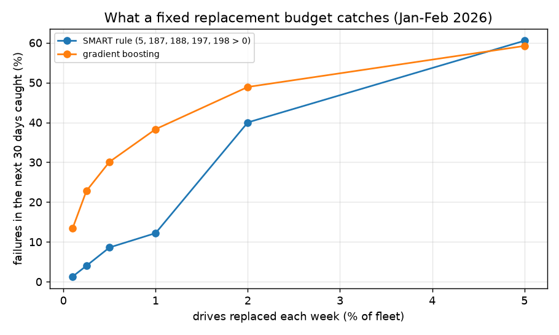

# assetwatch: Predictive Maintenance for a Fleet of 340,000 Hard Drives

A predictive-maintenance service built on **real telemetry from Backblaze's data centers**: 60.8 million daily
SMART readings from 348,272 hard drives (October 2025 – March 2026), including 1,975 real drive failures. The
project covers:
- **Ingest:** DuckDB streams 23 GB of daily CSVs into one 1.1 GB Parquet file, keeping data drives (4 TB and up)
  and dropping boot SSDs.
- **Features:** weekly fleet snapshots with SMART counter levels, how much each error counter grew over the past
  week, drive age and manufacturer. The label is whether the drive fails within the next 30 days.
- **Evaluation:** the question a maintenance team actually faces. *If we can proactively replace N drives a week,
  which ones?* The model is compared with the standard SMART rule at the same budgets.
- **A REST API** (FastAPI + SQLite) that ranks the fleet by risk, explains each drive's risk in plain words and
  plans work orders within a budget, never booking the same drive twice.

## Results

Trained on 8 weekly snapshots from October – November 2025 (the last 2 held out to calibrate probabilities), **tested
on 8 weekly snapshots from January – February 2026**: 2,672,278 drive-weeks, of which 2,483 failed within 30 days
(a 0.093% base rate). From `results/eval.json`:

| Drives replaced each week | Replacements | SMART rule catches | **Model catches** | Model precision |
|---|---|---|---|---|
| 0.1% of fleet | 2,674 | 1.3% of failures | **13.4%** | 12.5% |
| 0.25% | 6,680 | 4.0% | **22.8%** | 8.5% |
| 0.5% | 13,361 | 8.6% | **30.1%** | 5.6% |
| 1% | 26,723 | 12.2% | **38.3%** | 3.6% |
| 2% | 53,445 | 40.0% | **48.9%** | 2.3% |
| 5% | 133,613 | 60.5% | 59.2% | 1.1% |



- **At tight budgets the model is far better.** Replacing the riskiest 0.1% of drives, one in eight replacements
  is a drive that really was about to fail, 10× the rule's hit rate. The rule cannot tell a drive with one
  reallocated sector from one gaining thousands a week; the model can, because it sees growth.
- **At large budgets the advantage disappears.** At 5% the two are even, and used as a yes/no alert the rule flags
  8.24% of the fleet and catches 69.4% of failures, while the model given the same 8.24% catches 64.5%. Many
  failures give no SMART warning at all, so neither approach can find them, and the rule's broad net catches a few
  that the model ranks just below the cut.
- **PR-AUC:** 0.0575 for the model vs 0.0106 for the rule (a random ranking scores 0.0009).

**Probabilities.** Training with balanced class weights helps the ranking but inflates every score: the raw
model expected 42,351 failures on the test weeks against 2,483 real ones. Dividing out the class weight
under-predicted threefold, because early-stopped trees don't inflate by a clean factor, so the scores are instead
calibrated with isotonic regression on two held-out weeks. It is closer, not perfect:

| Risk rank (of 2.67M drive-weeks) | Expected failures | Observed |
|---|---|---|
| 1 – 100 | 55.9 | 38 |
| 101 – 1,000 | 223.8 | 144 |
| 1,001 – 10,000 | 408.3 | 499 |
| 10,001 – end | 729.4 | 1,802 |
| **Total** | **1,417** | **2,483** |

The top of the list is over-confident and the long tail is under-predicted: two calibration weeks hold only ~600
failures, too few to pin down the tail. So the API uses probabilities to sort and to set priority, and the fleet
total should be read as a rough figure. On the served data it is plausible: 310.6 expected failures in 30 days for
341,722 drives, about the fleet's historical rate.

## The API

```bash
uv sync
uv run assetwatch ingest      # data/raw/*.csv -> data/telemetry.parquet (see Data below)
uv run assetwatch evaluate    # results/eval.json, results/budget.png
uv run assetwatch load        # train on every labeled week, score the fleet on 2026-03-31 into SQLite
ASSETWATCH_DB=data/assetwatch.sqlite uv run uvicorn --factory assetwatch.api:create_app
```

| Endpoint | |
|---|---|
| `GET /fleet/summary` | fleet size, expected failures in the next 30 days, by manufacturer, open work orders |
| `GET /assets?min_risk=&manufacturer=&limit=&offset=` | drives ranked by 30-day failure risk |
| `GET /assets/{serial}` | one drive: model, age, risk, the reason, its work orders |
| `POST /work-orders/plan` `{"budget": 340, "min_risk": 0}` | open work orders for the riskiest drives without one |
| `GET /work-orders?status=open` | work orders |
| `PATCH /work-orders/{id}` `{"status": "completed"}` | close a work order (closing it twice returns 409) |

From the real fleet on March 31, 2026:

```text
ZLW0G69V  ST12000NM001G  risk 0.62  7,496 reallocated sectors (+6,576 this week); 33 uncorrectable errors
                                    (+27 this week); command timeouts; 6,928 pending sectors (+6,912 this week)
ZYD5H3MH  ST24000NM002H  risk 0.53  stopped reporting SMART health data, which preceded failure in about half
                                    of such cases
```

Planning a week's budget of 340 replacements (0.1% of the fleet) opens 50 urgent and 290 high-priority work
orders, which together account for 78 of the fleet's 311 expected failures.

**Design notes**
- One open work order per drive is enforced by a unique partial index in SQLite, not just by application code, so
  two planners running at once can't double-book a drive.
- A drive that suddenly stops reporting SMART data is a real signal, not a missing value to fill: in training, 6 of
  9 such drives failed within 30 days (30 of 60 in test). The reason text says so instead of showing a blank.
- Seagate packs several counters into the raw value of SMART 188, giving numbers in the billions; the reason text
  reports "command timeouts" instead of a meaningless count.

## Data

[Backblaze Hard Drive Data](https://www.backblaze.com/cloud-storage/resources/hard-drive-test-data), the daily
quarterly zips for Q4 2025 and Q1 2026 unzipped into `data/raw/` (23 GB). Each row is one drive on one day: serial,
model, capacity, a `failure` flag set on the drive's last day, and raw SMART values. Data and model files are not
committed.

Each snapshot needs the week before it (for growth) and 30 days after it (for the label) inside the data, which is
why training ends in November and testing ends in February. Snapshots exclude drives that fail on the snapshot day
itself, since there is nothing left to predict.

## Limitations

- Six months of data from one operator. Failure patterns shift with drive models and workloads, so the model
  should be retrained as new quarters arrive and checked against the rule each time.
- A "failure" is Backblaze removing a drive for failing. A drive replaced proactively before it fails never gets
  labeled, which in a real deployment would bias future training data toward drives that weren't replaced.
- Recall is counted per drive-week: a drive that fails is a positive on each weekly snapshot in the 30 days before
  it fails (2,483 positive drive-weeks), and each snapshot's top N is scored on its own. It does not model repair
  lead times or the effect of replacing a drive on later weeks.

## Tests

`uv run pytest`: synthetic CSVs check the ingest filter, the 30-day label and week-over-week growth; budget metrics
and the rule are checked by hand-computed cases; the API tests check planning order, no double-booking and the work
order lifecycle (404/409/422). CI runs lint and tests on every push.

Built with AI assistance (Claude Code). I reviewed the code and verified the results; the calibration and
missing-SMART findings above came from checking the model's output against the data.
